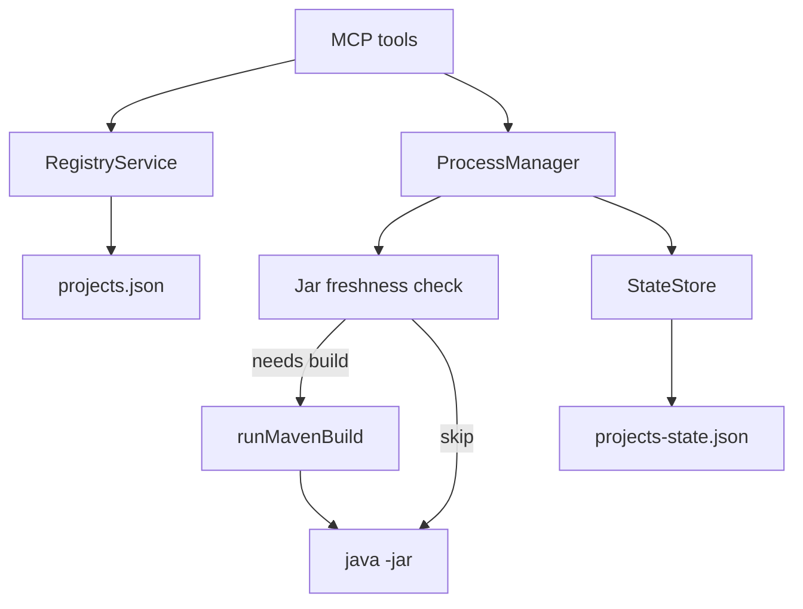

# Design: Smart start build, registry CRUD, reclaim / force_stop

**Date:** 2026-10-31  
**Status:** Approved for planning  
**Scope:** Address v1 pain points (1) always-package-on-start latency, (2) hand-edited registry only, (4) post-restart `unknown` / cannot stop safely.

## Goals

1. Skip Maven package when the resolved JAR is fresh enough; allow explicit `skipBuild` / `rebuild`.
2. Add MCP tools to register, update, and unregister projects in `~/.java-project-runner/projects.json`.
3. Strengthen boot `recover`, add `project_reclaim` and fingerprint-gated `project_force_stop` (no blind kill).

## Non-goals

- Cross-process locks for multi-client (Cursor + Claude Code) concurrent use.
- Monorepo auto-discovery / `project_suggest`.
- `spring-boot:run` mode.
- Linux / Windows process-group parity beyond current macOS v1.
- Changing default stop-by-pgid safety model.

## Decisions locked with user

| Topic | Choice |
|-------|--------|
| Start build | **C**: smart skip by default + `skipBuild` / `rebuild` overrides |
| Registry | **B**: `project_register` / `project_unregister` / `project_update` |
| Reclaim | **B**: stronger `recover` + `project_reclaim` + `project_force_stop` (fingerprint required; no blind kill) |

## Architecture

Existing patterns stay: `shell: false`, goal/profile/jvmArgs whitelist, path-inside-root for JARs, `ProjectIdSchema`, per-project in-process mutex, file lock on state writes.

---

## 1. Smart start build

### Tool params

`project_start` and `project_restart` gain:

- `rebuild?: boolean` — force Maven (`package` / configured `buildGoal`) before start.
- `skipBuild?: boolean` — never Maven; require resolvable existing JAR.

Rules:

- Both `true` → `INVALID_ARGS`.
- Neither set → **auto**: skip build iff resolved JAR exists and is fresh (see below); else build.
- `rebuild: true` → always build.
- `skipBuild: true` → never build; if JAR missing/unresolvable → `START_FAILED`.

### Freshness definition

Compare mtime of the **resolved** JAR path to the newest mtime among:

- `<projectRoot>/pom.xml`
- Under `<projectRoot>/src/**` (recursive): files ending in `.java`, `.xml`, `.yml`, `.yaml`, `.properties`

If JAR missing → not fresh (must build, unless `skipBuild`).  
If `src/` missing → only `pom.xml` (and JAR existence) matter.  
No Maven reactor / dependency graph analysis.

### Response fields

Start/restart success payloads include:

- `buildSkipped: boolean`
- `buildSkipReason: string | null` (e.g. `jar_fresh`, `skipBuild_flag`, `null` when built)

### Implementation sketch

- New helper e.g. `src/services/jar-freshness.ts` with pure functions for testability.
- `ProcessManager.startCore` / restart path branch before `runMavenBuild`.

---

## 2. Registry CRUD

### Tools

| Tool | Input | Behavior |
|------|-------|----------|
| `project_register` | Full project config (same schema as registry entry) | Append if id free; validate; atomic write |
| `project_update` | `projectId` + partial fields (not `id`) | Merge, re-validate whole entry + registry, write |
| `project_unregister` | `projectId` | Remove entry; refuse if runtime status is `running`, `starting`, `stopping`, or `unknown` |

### Validation on write

Reuse existing load-time checks:

- `ProjectConfigSchema` / `ProjectIdSchema`
- Unique ids
- `healthCheckUrl` loopback if set
- `assertAllowedGoal` / `assertAllowedProfile` / `assertAllowedJvmArgs`
- `path` must exist as a directory; prefer requiring `pom.xml` present (fail register/update with clear error if missing)

### Persistence

- Add file-locked read-modify-write for `projects.json` (mirror `StateStore.withFileLock` pattern).
- Hand-editing the file remains supported.
- README: registry is no longer “hand-edited only”; tools + hand-edit both OK; still one MCP process per home.

### Unregister vs running process

If managed process is active or `unknown`, unregister fails with guidance to `project_stop` / `project_force_stop` first. Does not kill.

---

## 3. Recover, reclaim, force_stop

### Stronger `recover()`

On MCP boot, for state in `running` | `starting` | `stopping`:

- If PID alive and `cmdlineMatchesManagedJava(pid, jarResolved)` → set `running`, clear error, keep `pid`/`pgid`/`jarResolved` (do **not** null them out).
- In-memory `live` may lack a `ChildProcess` handle after restart; stop/force_stop already can use persisted `pgid`/`pid` + fingerprint — keep that path.
- Else → `unknown` as today (clear pid/pgid, record reason).

### `project_reclaim`

- Input: `projectId`
- Re-read state + registry; verify PID/cmdline against `jarResolved` (or re-resolve jar from config if state jar empty and project enabled).
- Success → `running` + message.
- Failure → `unknown` + reason; does not kill.

### `project_force_stop`

- Input: `projectId`, `confirm: true` (required literal), optional `timeoutSeconds`
- Refuse if `confirm` not true.
- Refuse if no pid/pgid.
- Refuse if PID alive but cmdline does **not** match managed java -jar fingerprint (no blind kill).
- If match (or PID already dead after match was established for pgid path): SIGTERM → wait → SIGKILL on managed pgid, same as stop.
- Clears `unknown` to `stopped` on success.

### `project_stop` unchanged for unknown

Still refuses `unknown`; tool description / error text points to reclaim or force_stop.

---

## Error codes

Reuse existing `AppError` codes only (no new codes):

- Duplicate project id → `INVALID_ARGS`
- Unregister while `running` / `starting` / `stopping` / `unknown` → `BUSY`
- Other failures → existing `NOT_FOUND`, `START_FAILED`, `BUILD_FAILED`, `NOT_RUNNING`, `PATH_DENIED`, `INVALID_ARGS` as appropriate

---

## Testing

| Area | Cases |
|------|-------|
| Freshness | JAR newer than sources → skip; source newer → build; missing JAR → build; `rebuild`/`skipBuild` conflict; `skipBuild` without JAR fails |
| Registry | register ok; duplicate id; bad id traversal; update merge; unregister ok; unregister while running refused |
| Reclaim / force_stop | reclaim success/fail; force_stop without confirm; force_stop mismatch refuse; force_stop match stops |

Prefer unit tests with temp dirs / mocked pid helpers where process APIs are already exported (`isPidAlive`, `cmdlineMatchesManagedJava`).

---

## Docs

Update README:

- Tool table for new tools and start params.
- Replace “Registry is hand-edited only” with tools + hand-edit.
- Note smart skip + overrides.
- Note reclaim / force_stop safety.

README locked-behavior section documents these as **v1.1** additions. Implementation plan bumps `package.json` version from `1.0.0` to `1.1.0`.

---

## Risks

| Risk | Mitigation |
|------|------------|
| Smart skip misses non-`src` resource changes | Document scope; user passes `rebuild: true` |
| Agent sets `skipBuild` on stale tree | Explicit opt-in; default auto still rebuilds when sources newer |
| Registry write races with hand-edit | File lock; document single-writer preference |
| force_stop misused | `confirm: true` + fingerprint gate |

## Success criteria

- Start without source changes completes without Maven when JAR is fresh.
- Agent can register/update/unregister without editing JSON by hand.
- After MCP restart, matching processes reclaim to `running`; `unknown` can be force-stopped only when fingerprint still matches.
